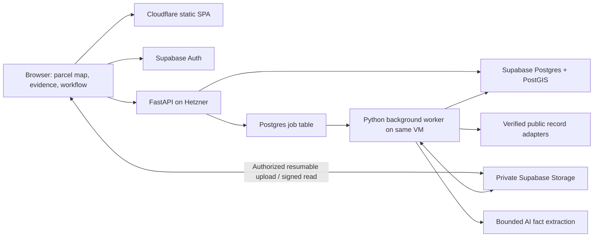

# Davapprove MVP application architecture

Implementation update (November 7, 2026): this document is the design/acceptance target. See [implementation status](IMPLEMENTATION_STATUS.md) and [operations](operations.md) for the deployed MVP, verified behavior and remaining work.

Decision baseline: November 7, 2026. Implements the [requirements](MVP_REQUIREMENTS.md) and [sprint plan](FEATURE_1_SPRINT_PLAN.md). The recommended deployment is a small modular application with managed Postgres/auth/files and one replaceable processing server. It is intentionally not a microservice platform.

## Deployment and budget

| Component | Initial choice | Monthly planning allowance |
| --- | --- | ---: |
| Web UI | React + TypeScript + Vite, Cloudflare Workers Static Assets; static SPA, no SSR | $0 |
| Data, identity and files | One Supabase Pro Micro project: PostgreSQL/PostGIS, Auth, private Storage | $25 |
| API and processing | One Hetzner Linux VM, at least 2 vCPU/4 GB RAM, Docker Compose | Up to $12 |
| Auth email | Resend free transactional SMTP on a verified domain | $0 within free limits |
| AI extraction | One configurable hosted model through a narrow provider adapter | $5 hard application allowance |
| Domain | Annual registration amortized; reuse an existing domain if available | $2 allowance |
| **Planned subtotal** | Includes a modest AI trial allowance | **Up to $44** |

Reserve the remaining **less than $6** for taxes, storage backup and small variable charges; total recurring target stays **below $50**. These allowances are a purchasing constraint, not a guaranteed supplier quote. Before provisioning, verify the actual VM region/availability, IPv4 if used, taxes, domain renewal and vendor totals. If the quote exceeds the ceiling, reduce optional AI allocation or select a cheaper suitable region; do not silently add paid services. No infrastructure has been provisioned by this document.

[Supabase pricing](https://supabase.com/pricing) lists Pro from $25, compute credits sufficient for one Micro instance, 8 GB database, 100 GB files, 250 GB egress and daily database backups retained seven days. Use a single paid project; local development avoids another paid environment. [Cloudflare static assets](https://developers.cloudflare.com/workers/static-assets/billing-and-limitations/) are free to serve; keep application compute on the VM. [Hetzner's catalog](https://www.hetzner.com/cloud/) is region/capacity dependent and did not expose a dependable final quote in this review; the $12 line is a ceiling to verify, not a validated SKU price.

Configure [custom SMTP](https://supabase.com/docs/guides/auth/auth-smtp) for external beta users: Supabase's built-in sender is restricted and unsuitable. [Resend's free tier](https://resend.com/blog/new-free-tier) advertises 3,000 emails/month and 100/day; verify current [pricing](https://resend.com/pricing) at setup. Invitation-gated email-link signup limits abuse and supports nontechnical clients.

Use Supabase Storage initially because it is already included. Introduce [R2](https://developers.cloudflare.com/r2/pricing/) for independent file backup or later egress economics, not as a mandatory second primary store. A fully self-hosted Postgres/auth stack saves subscription cost but adds recovery and security work. An AWS multi-service deployment or all-Cloudflare processing stack adds setup/runtime decisions that do not improve this pilot enough to justify them.

## Runtime structure

Choose React with MapLibre GL JS for the map, React Flow for the secondary dependency view, and PDF.js for document viewing. Use a basemap permitted for hosted commercial use, with attribution; default to an attributed OSM raster layer only while complying with the [tile service usage policy](https://operations.osmfoundation.org/policies/tiles/), including caching and request identification, with no bulk download/prefetch. Keep tile URL configurable and validate pilot traffic before launch; if the tile service is unavailable, retain parcel/constraint overlays and show a basemap-unavailable notice. The parcel/constraint overlays are the core product, not a paid map API dependency.

Use Python FastAPI/Pydantic for the API and a separate Python worker process from the same codebase. Use PostGIS for canonical geometry operations; normalize geometry from source CRS, compute distance/area in an appropriate local projected CRS (EPSG:2285 for this pilot, US survey feet), and return GeoJSON in EPSG:4326. Validate conversions and unit labels in fixtures. Python runs PDF text extraction, Tesseract OCR and bounded public-source HTTP/browser adapters. An isolated browser adapter is added only when the source-access spike proves it necessary.

One Compose deployment runs HTTPS reverse proxy, API and worker. The VM holds temporary files, not the only copy of project data. Cap heavy-job concurrency at one, memory/time per job, download bytes and total temporary disk; clean temporary files on success and failure. No Redis, graph database, vector database, Kubernetes, persistent agent runtime or always-on paid OCR service in v1.

## Evidence and revision model

Implement normalized relational entities with JSON only for adapter payloads and variable fact values:

| Entity group | Required meaning |
| --- | --- |
| Projects and memberships | Project owner, editor or reviewer; current revision; normalized parcel ID, source identity and address aliases. Membership is the access boundary. |
| Source runs and candidates | Source/query scope, timing, completeness, raw response reference/hash, external record ID, URL, match basis, metadata and import selection. Candidates do not become evidence automatically. |
| Documents and versions | Project-local identity, immutable blob key, hash, size, source/retrieval date and document date; separate supersession from deletion. |
| Facts and reviews | Typed value, units, document version/page/quoted support or source-record field, extractor version, confidence, review state, actor and timestamp. Conflicting facts coexist until a reviewer resolves them. |
| Project revisions and geometries | Immutable snapshot manifest of accepted facts, document versions, intent, constraints and geometry references; parent revision and author. Geometry includes CRS, source and accuracy category. |
| Rule packs and graph instances | Jurisdiction, version/effective period, rule citations, predicates, node IDs, typed edges and applicable milestone. Evaluations bind revision + rule version + as-of time and store reason traces. |
| Decisions and conditions | Source-reported agency decision and scope/revision, source evidence, effectiveness and stage-specific conditions; never overwritten by model predictions. |
| Jobs, comments and events | Durable job progress/retries, revision-linked comments and append-only action history. AI usage/reservations tracked by job and month. |

Use UUID identifiers, UTC timestamps and explicit local-date handling for legal deadlines. Index project IDs, membership lookups, source external IDs and job status/run-after; GiST-index queried geometries. Enable [row-level security](https://supabase.com/docs/guides/database/postgres/row-level-security) and private storage policies for project membership. [PostGIS is supported](https://supabase.com/docs/guides/database/extensions/postgis). Shared public GIS cache contains no private uploads or project review results.

For user-facing data operations, the API forwards the verified user's token through Supabase's data API/RPC so RLS stays effective. Never use the service role as a general user query credential. The worker uses a server-only restricted role and narrowly scoped transactional job functions; enforce project identity from the claimed job, not arbitrary browser-supplied values. Prevent cross-project foreign-key associations as well as unauthorized reads. No service credentials in the SPA.

Commit an accepted review/revision atomically using expected-current-revision matching; reject concurrent stale updates with a conflict response. Agency evidence remains historical even when project reliance changes. A future branch is another revision lineage, not a copy of every document.

## Minimal API and job contracts

Version the API under `/api/v1`; return validated JSON and an OpenAPI contract. All project routes require membership; modifications require owner/editor, comments also allow reviewer.

- `POST /projects`: parcel input + intent → project and initial revision after parcel confirmation.
- `POST /projects/{id}/discover`: selected source scope → job ID; `GET /projects/{id}/candidates` returns progressive metadata and source coverage.
- `POST /projects/{id}/imports`: candidate IDs + idempotency key → immutable selection manifest and import jobs. Validate candidates belong to the project. Repeated requests do not duplicate work.
- `POST /projects/{id}/uploads` and completion route: authorize a unique private object path, then verify actual size/type/hash before processing. Use direct resumable Storage upload; no large PDF request body through the API proxy.
- `GET /jobs/{id}`: status, stage, bounded progress, errors and retryability; cancellation/retry routes check project membership.
- `GET /projects/{id}/review` and `POST /projects/{id}/revisions`: candidate facts and reviewed changes + expected revision → new snapshot. Accepted geometric edits include source and accuracy.
- `GET /projects/{id}/revisions/{revision}/assessment`: envelope GeoJSON, coverage gaps, graph states and cited next actions pinned to ruleset/as-of time. File-read route issues short-lived signed URLs only after authorization.
- `POST /projects/{id}/comments`: text + document/node/revision reference. Print briefing uses the same assessment payload; no separate interpretation engine.

Adapter contract: `discover(parcel_context, cursor) → candidates, coverage, next_cursor`; `fetch(selected_candidate) → bounded file stream + source metadata`. A manual-only source returns a portal link and explanation rather than fabricated candidates. Match ambiguities are reviewable; do not automatically attach nearby-parcel documents.

Postgres jobs use transactional claim, lease expiry and heartbeat with `FOR UPDATE SKIP LOCKED`, three bounded retries for transient failures, and explicit permanent failure/manual-access states. Document stages are idempotent by project/document hash/extractor version; discovery jobs use project/source/query snapshot and imports use the selection manifest. Network work happens outside DB transactions. Retry may repeat requests, but cannot duplicate committed versions, accepted facts or AI budget reservations. Poll the job API; WebSockets are unnecessary.

## Rule packs and AI boundary

Keep jurisdiction packs in version-controlled data, validated against a shared schema. Each includes authority/boundary references, supported project types, source-adapter configuration, citations/effective dates, required inputs, reviewed numerical rules, typed dependencies and fixtures. Packs are explicitly county or Poulsbo; shared state/KPHD modules are composed only where applicable. No implicit “city overrides everything” or “county is the fallback” precedence.

New municipality workflow: verify boundary and authorities → inventory official code/amendments/maps/portals → map terms to shared facts/nodes → implement only cited predicates → test representative local parcels and unresolved cases → sponsor/domain review → publish version and coverage statement. A later rule update generates an impact comparison; existing projects stay pinned until reviewed. Unresolved code conflicts or vesting are review tasks, not AI tie-breakers.

The evaluation function is pure: accepted snapshot + jurisdiction pack + as-of date → states, preliminary geometry and explanation trace. Sort only milestone prerequisites; validate that projection for cycles. Keep INVALIDATES links outside the ordering DAG and traverse them with visited-node guards. Missing inputs yield unknown; legal and recommended blocks have different presentation.

AI receives selected document text/page chunks, a fixed extraction schema and an allowlisted task. Treat document content as untrusted data, never executable instructions. Validate citations against supplied pages; require human acceptance for facts used in geometry or determinative rule evaluation. Store model/prompt version and output separately from accepted facts. Use deterministic templates to explain rule results; optional AI paraphrases must preserve cited facts and cannot alter states.

Use a provider-neutral extraction interface and choose the initial model by a small fixed-document accuracy/cost evaluation in Milestone 2. This is a deliberate implementation gate: no provider/model price is assumed here. Reserve worst-case request cost before calls, cap tokens and retries, reconcile actual usage, and stop new AI work at the $5 monthly allocation. Text extraction/manual review continue when AI is unavailable. Do not send whole 250 MB PDFs to a model by default.

## Security, operations and growth

Use private buckets, authenticated downloads and a sandboxed PDF viewer. Validate file signatures as well as extensions; parse/OCR in a non-root, resource-limited container. Source fetchers permit only registered HTTPS hosts, validate redirects and resolved addresses, and block private/local destinations. Uploaded documents never supply tool permissions or arbitrary network targets. Expose only HTTPS publicly; restrict SSH to operator access and apply VM security updates.

Default quotas: 10 invited users, 20 active projects, 10 GB pilot files, 250 MB/500 pages per PDF, one concurrent discovery per project and bounded source request rates. Baseline metadata is small; discovery does not crawl entire portals. Alert at 70% of allocations and stop optional imports/AI at the configured limit. Keep authenticated views and already imported records usable. Vendor billing controls and an application quota reduce cost risk but do not constitute a universal hard invoice cap; check usage weekly during the pilot.

Use Supabase's daily database backup plus a weekly encrypted logical export and daily incremental copy of private objects to an independent operator-owned backup destination. If using R2 for that copy, include its measured cost in the reserve. Database backups alone are not file backups. Keep a manifest tying blob hashes to metadata; test a database-plus-file restore before inviting clients. Target recovery point: 24 hours; recovery within one working day. These are pilot targets, not an SLA.

Deploy from GitHub Actions: type/lint/unit checks, local Postgres integration tests, browser flow checks, versioned container build, migration, frontend deployment and API/worker restart. Keep migrations backward-compatible with the prior app version; rollback app images independently of data, and document recovery for destructive migrations. Use local Supabase and synthetic fixtures for previews so unreviewed builds cannot write production. Logs capture job IDs, source failures and timings without PDF contents or tokens; expose health and last-successful-worker checks.

Later, move the same worker image to managed jobs or add replicas when measured queue delay warrants it. Move files behind the storage adapter to R2 when economics justify it. Extend revision manifests into proposal/review/merge workflows with discipline signoff and conflict detection; add scheduled source refresh and municipality packs incrementally. Full-text search precedes embeddings; a graph database is unnecessary until actual graph query demands justify one. Deterministic rules and immutable evidence remain the stable core throughout.
