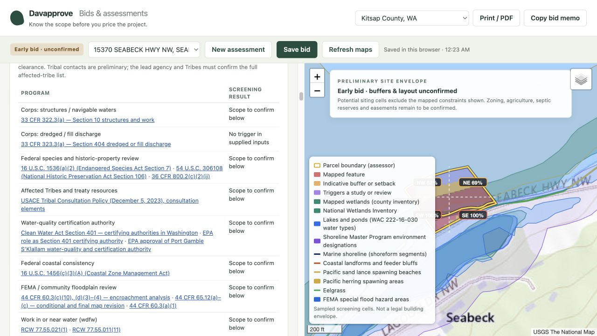
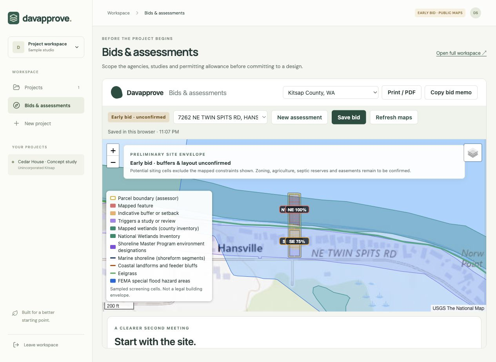

# Bid Assistant

Built November 12, 2026 on branch `claude/vibrant-archimedes-25i4ue`. Code and fee research date: November 12, 2026.

## November 14, 2026: independent agency coverage

The bid engine now runs independent tribal, state and federal program checks from the **proposed activity**, land-status assumptions and public agency layers. County permit summaries are not consulted by these rules. No document import, OCR, title parsing or approval reconciliation was added.

- **Corps:** Section 10 structures/work in navigable water and Section 404 dredged/fill discharge are separate rules. Marine and freshwater projects are screened; a dock does not automatically trigger Section 404. A wetland-fill question no longer depends on how much of the parcel is constrained. Missing aquatic maps remain unresolved.
- **Tribes:** independent state tribal-land results are retained even when county boundaries fail, including additional tribal names. Tribal land permission, treaty/cultural consultation and water-quality certification have separate roles. Suquamish, Port Gamble S’Klallam and Skokomish are sourced regional starting contacts; **this is not a complete affected-tribe list**. The federal lead and Tribes must establish the full list for the actual waterbody and activity. Unrecognized names are never silently mapped to Suquamish or Port Gamble. Reservation, trust/fee and zoning labels alone do not decide permitting authority.
- **Water-quality certification:** route to Ecology, an authorized Tribe or EPA according to the work/discharge location; unknown or conflicting jurisdiction keeps alternatives open. EPA’s published Port Gamble S’Klallam approval is attached to that candidate route. Certification coverage and conditions still require confirmation; the system does not infer authority from fishing rights alone.
- **DNR / WDFW:** freshwater and marine aquatic work retain independent land-use and hydraulic-permit checks. DNR ownership is evaluated at the proposed footprint, not inferred from a nearby polygon or lack of a map hit. Recreational rent-free use does not waive other permits.
- **Floodplain:** independent FEMA data and reported floodplain activities trigger local-administration, hydraulic/no-rise and conditional-map-revision checks. Reported encroachment and rise exceeding the cited federal thresholds produce a CLOMR requirement for the supplied scenario. Unknown rise is not zero; a supplied no-rise result is not certified by this tool. Community standards may be stricter, and a CLOMR is not local construction permission.
- **Other federal roles:** species and historic-property review follow a potential federal permit or reported federal action. Consultation with both wildlife agencies is not automatically asserted. Coastal consistency remains separate from water-quality certification.
- **Stormwater / environmental review:** common-plan development is screened even below the individual-site disturbance threshold. EPA is considered for Indian Country and federal operators instead of automatically applying Ecology’s price. SEPA lead identity is not assumed to be the county on city, tribal or federal projects.

The optional **Agency scope** accordion supplies water setting, discharge, navigability, jurisdiction, flood footprint/rise, floodway adoption and federal/common-plan assumptions. A parcel without a floodway hit does not establish that no floodway was adopted for the river reach. These are reported bid inputs, not agency decisions. Saved drafts and copied memos preserve them; older drafts default missing answers to unknown. The **Agency checks beyond county records** panel lists the programs screened, their sources and whether follow-up remains. “No trigger in supplied inputs” is explicitly not a clearance.

Every new finding retains sources, source-check date, jurisdiction, work stage and an empty approved revision. New hydraulic analysis, FEMA map review, certification support and EPA stormwater price gaps are **quote needed**, excluded from priced totals until the user supplies an allowance. Alternative certifiers share one preparation allowance rather than duplicating that study.

Source records are in `data/citations.json`, `data/fees.json` and `data/agency-routing.json`; the contact shortlist is a proposed workflow, not a treaty-boundary database. Direct DNR PDF retrieval was refused, so that record discloses use of official indexed text and is not marked quote-verified. The earlier county-code library has not been re-certified. All newly reviewed sources are dated **November 14, 2026**.

Validation covers county outages, explicit fill without map hits, no-fill marine docks, freshwater navigability, state/tribal/EPA routing, unidentified tribal names, conflicting jurisdiction, common-plan stormwater, FEMA threshold boundaries, unpriced costs, saved scope, legacy defaults and memo provenance. Live browser verification used the Hood Canal dock example and saved-bid reopening. Memo generation and delivery to the clipboard API were verified in the DOM test; the browser automation clipboard reader returned an older memo, so live clipboard contents were not independently verified. No new parcel services or document fetches were added.



CLI examples accept the same scope inputs, such as `--waterbody freshwater --fill-discharge no --land-status tribal --common-plan` and `--flood-work yes --floodway-work yes --flood-rise-ft 0.1`. These values describe a scenario, not a verified legal conclusion.

## November 13, 2026: bid workspace integration

The beachhead is a **bid assessment**, independent of the records/approval workflow. The local application and standalone research branches were combined on `codex/bid-assessment-workspace`; the original project, private records, site-envelope and workflow implementations remain available.

- The application sidebar has **Bids & assessments**. The welcome screen also links directly to the public screening tool, without creating a project or starting document discovery, OCR, AI processing or a fact-review queue.
- Saved assessments retain the parcel map snapshot, project assumptions, cost overrides, quote/exclusion notes and assessment title. They are explicitly **browser-local**, not authenticated team storage. A saved bid opens without fetching documents or re-querying maps; **Refresh maps** rechecks public sources while retaining the bid's assumptions and allowances. Clearing browser storage removes these drafts. The copied memo is a separate portable record.
- The map says **Early bid · buffers & layout unconfirmed**. Potential siting cells are distinguished from mapped features, indicative buffers and study areas. Incomplete maps, city coverage and uncertain jurisdiction make remaining cells gray and unresolved. Cells are a sampling visualization, not a surveyed boundary or a legal buildable-area determination.
- Permit fees, professional studies, impact fees and listed connection charges are priced separately. Editable ranges and exclusion notes propagate to the subtotal, agency details and memo. Reset restores the reference price; exclusions never remove requirements. Invalid or reversed ranges cannot change totals. Small published fees remain visible instead of rounding to zero.
- Unsourced consultant placeholders are now **Quote needed** and are excluded from priced subtotals until a user supplies an allowance. Published local professional estimates were refreshed from [Studio Kamppari's Kitsap fee guidance](https://www.studiokamppari.com/articles/soft-costs), checked November 13, for geotechnical reports, geological assessments, septic design, mitigation planning and surveys. Shoreline mitigation remains a scope proxy, explicitly identified. No inflation factor or firm quote is invented.
- Expired/incomplete permit summaries prompt a **reuse check**, citing [DCD1014POL](https://www.kitsap.gov/dcd/Documents/Reactivation%20and%20Extension%20Policy.pdf). The issuing agency must decide reactivation, revision, reuse or replacement. No automatic credit or fresh-application determination is made from table status alone.
- Failed/truncated sources remain visible. Unconfirmed jurisdiction suppresses county-specific permitting prices and buffer calculations. Owner/applicant names and free-text permit project names are not requested; DNR queries only return state-land classifications, not owner identities.



### Running the integrated application

```sh
cd web
npm install                 # only if dependencies are absent
npm run dev
```

The `predev` and `prebuild` scripts copy an allowlisted set of screening assets into `web/public/bid-assistant/`. These generated copies are ignored; edit `bid-assistant/`, then restart development or run `node scripts/sync_bid_assets.mjs` from the repository root. Production builds include the standalone route at `/bid-assistant/index.html`. No production deployment was made in this change. On a static host this route uses public GIS CORS; the optional relay is available through the standalone server, not automatically through the application host.

### Verification and remaining scope

Validated: production web build, the existing frontend suite (including navigation to bids and back without changing project revision), engine/geometry regression tests, saved-draft tests, synthetic DOM integration and live Hansville parcel screening. Browser checks exercised a quote edit, memo export and saved-bid reopening. Synthetic tests cover missing map responses, quote gaps, invalid ranges, exclusion provenance, storage quota/corruption and failed lookups. These checks validate software behavior, not all underlying law or published prices.

Pricing covers **unincorporated Kitsap and selected fees for all four incorporated cities** (see the November 14 fee updates below). Municipal allowances use city schedules, with separate quote-needed items for unresolved scope. City buffer geometry remains unmodelled. Agricultural/resource-land buffers, full zoning setbacks/allowed use, recorded easements/plat conditions, septic reserves and legal lot status remain explicit confirmation items; they are not geometrically resolved by this map. Some older code sources and consultant estimates still need professional review. Browser-local saving is intentionally separate from the private project's revision/approval model; team synchronization and converting a bid to a project are not implemented.

Additional checks (the DOM integration test uses the web checkout's installed `jsdom`):

```sh
node tests/bid_assistant_drafts.test.cjs
node tests/bid_assistant_ui.test.cjs
cd web && npm test && npm run build
```

## What it is

A standalone feature for the first or second client meeting. Put in a Kitsap County parcel and a project type; get back:

1. **Who is involved**: screened agencies, districts, tribal contacts and consultants the project may involve, each with the reason and the code section behind it.
2. **What to add to the bid**: permit fees and pre-construction studies as a low to high range, every line tied to a published fee schedule or a named market source.
3. **Where the lot is constrained**: mapped critical areas, standard buffers, shoreline and flood zones, as a share of the lot and by quadrant, drawn on an aerial map.
4. **What may need to be redone**: county permit summaries, with lapsed and incomplete records flagged for agency confirmation of reuse, revision or reactivation.

It is deliberately not the approval-dependency model. It reads maps and published code; it does not ingest a parcel's document history and it does not require bulk manual fact verification to produce a bid screen; flagged site-specific questions still need confirmation before a fixed bid. The dependency graph research in `docs/research/` is untouched and remains the reference for the workflow feature.

## Run it

```sh
node bid-assistant/server.js          # then open http://localhost:8080
node bid-assistant/cli.js "614 Division St" --type new_sfr      # Markdown memo
node bid-assistant/cli.js 1248699 --type shoreline_structure --json
```


No install step and no dependencies beyond Node 18 or newer. The page is static files plus live requests from the browser to public map services, so it can be hosted anywhere. Leaflet 1.9.4 is vendored under `bid-assistant/vendor/`.

Hosting note: most map servers accept requests straight from the browser, but some state servers (Ecology in particular) refuse them intermittently. `server.js` includes a small relay, limited to the public data hosts the tool uses, that the page falls back to automatically. On a plain static host without that relay, an affected layer shows as "could not check" rather than failing silently.

Checks:

```sh
node tests/bid_assistant_geo.test.cjs       # geometry, no network
node tests/bid_assistant_engine.test.cjs    # rules and data integrity, no network
node tests/bid_assistant_live.cjs           # screens six real parcels; needs network
```

## How it is put together

| Piece | File | Job |
|---|---|---|
| Jurisdiction pack | `packs/wa-kitsap.js` | The only place that knows a county's map services and field names. Finds a parcel, lists layers, turns raw hits into neutral facts. |
| Screening | `lib/screen.js`, `lib/arcgis.js` | Runs every layer against one parcel. Reports `on_parcel`, `nearby`, `none` or `unknown` per layer. |
| Geometry | `lib/geo.js` | Distances, areas and a sampling grid that measures how much of the lot each constraint covers, by quadrant. |
| Rules | `rules/federal.js`, `rules/wa-state.js`, `rules/wa-kitsap.js` | 36 rules. Each restates a published trigger against the facts and the project, and names its citations and cost lines. |
| Engine | `lib/engine.js` | Evaluates rules, rolls findings up by agency, merges cost lines into base and contingency totals. |
| Research data | `data/citations.json`, `data/fees.json`, `data/agencies.json` | The citation library, cost lines and agency directory. `data/research/` holds the fuller research files they were built from. |
| Outputs | `app.js`, `lib/report.js`, `cli.js` | Web page, Markdown bid memo, command line. |

The editable runtime source of truth is `data/citations.json` and `data/fees.json`. After editing them, run `node bid-assistant/build.js`. The older research transformer (`tools/make_data.js`) can overwrite subsequent curated edits; use it only when intentionally reconciling changed research with the runtime data.

### Vocabulary

Every finding has a level and a basis. These follow the project rule of keeping documented requirements, proposed workflow steps and open agency questions apart.

| Level | Meaning | Where its costs go |
|---|---|---|
| required | A documented trigger is met by the project or by a feature mapped on the lot | Base estimate |
| likely | A mapped feature is close enough that the code calls for review; outcome depends on field work | Base estimate |
| possible | Depends on something maps cannot show | Contingency |
| unknown | The map layer could not be read | Shown as "could not check" |

Basis is `documented` (the cited text states the trigger), `workflow` (a recommended step, not itself a code requirement) or `confirm` (a question the agency must answer). The tool never says something is not required. A failed map request always surfaces as "could not check", never as a clean result.

### Map layers (29 for Kitsap)

Kitsap County GIS: parcels, assessor land and building tables, permit table, zoning, city limits, urban growth areas, reservation boundaries, fire and water districts, county sewer areas and mains, airport overlay, wetland inventory, streams with water type, geologic hazard areas, aquifer recharge areas, shoreline designations. Kitsap DCD environmental service: lakes, marine shoreline, shoreline armoring inventory, feeder bluffs, forage fish spawning, eelgrass. FEMA: special flood hazard areas. State and federal: National Wetlands Inventory, Ecology tribal lands, WSDOT state routes, DNR aquatic land ownership, DAHP archaeological risk model.

One layer needed special handling. The county publishes each geologic hazard class as a single county-wide polygon of about 34 MB, too large to download per parcel. The tool instead asks the server yes or no questions about progressively smaller rectangles across the lot (about 150 small requests) and treats the answer as a coarse grid, which is why hazard coverage is described as sampled.

## What was verified and what was not

Read this before showing numbers to a customer.

**Code citations: 132 entries.** The original research reported 105 machine-matched quotes. The November 13 update adds a directly checked reactivation-policy excerpt and an explicitly unverified code-applicability pointer for site restrictions; it does not re-certify the earlier library.

- Kitsap County's official code host (ecode360) refuses automated access. No attempt was made to get around that. Kitsap sections were instead verified against the county's own published documents, and each citation records which one:
  - Title 19 critical areas: Ordinance 633-2024, effective April 1, 2025. This is the current update. It raised stream buffers (Type F 150 to 200 ft, Np and Ns 50 to 100 ft) and the wetland inventory distance (250 to 300 ft).
  - Title 22 shoreline: Ordinance 598-2021 as locally adopted, before Ecology's final approval.
  - Title 12 stormwater: Ordinance 599-2021. A 2026 update was before the Planning Commission; adoption status unknown.
  - Titles 11, 13, 14, 15, 16, 18, 21: the county's archived code snapshot dated December 2019.
  - ADU rules (17.415): the county's February 2026 handout and a 2025 staff report quoting the code.
- Because of this, most Kitsap citations link to the code's front page rather than the exact section. **A person should click through each Kitsap citation on ecode360 once** and record the deep link and any text change. The page shows "may be outdated" on every citation that came from an older copy.
- Older city code chapter references remain unverified and are retained as research records, but are no longer asserted in the city-routing finding. The municipal updates verify selected official fee schedules and published application guidance, not full city code applicability or city buffer geometry.
- The complete tribal/local permitting split is not established by the checked sources. Port Gamble S’Klallam publishes environmental and certification material, and EPA confirms its certification authority; those sources do not resolve every parcel-specific land-use question.

**Agency fees: all from published schedules fetched November 12, 2026.** Kitsap DCD fee schedule revised June 3, 2026, with building valuation rates effective November 1, 2026; Kitsap Public Health 2026 schedule; county impact fee table revised September 24, 2026; county sewer charges effective January 1, 2026; state and federal fees from current WAC, RCW and CFR text. The building permit, impact fee and electrical figures are computed from published formulas; the county does not print worked totals. The county's own handout gives $7,899 for a 2,000 sq ft house under the previous valuation rates, against $8,293 computed here under the current ones.

The county fee schedule has **no line** for reviewing a wetland, habitat or geotechnical report, for buffer averaging, or for floodplain review. The tool says so and prices nothing for them. Ask DCD.

**Consultant costs are market ranges, not quotes.** Thirteen lines have named sources, including the local architect guidance refreshed November 13, the City of Bellevue on-call form from 2020 and other published market references. None is rated high confidence. Five have no source: civil engineering, elevation certificate, SEPA checklist, hydrogeological report and JARPA preparation. Their legacy placeholder values remain in the research records but the UI and memo show **Quote needed**, excluding them from totals until a user enters a range. Source dates and scope limitations remain visible. Local consultant quotes are still preferable.

**Maps.** Positions are approximate at lot scale. Buffers are measured from mapped lines, not from a located ordinary high water mark or a delineated wetland edge. Zoning setbacks, septic reserve areas, easements and slopes not on the hazard map are not in the constrained-area figure.

## Known limits and next steps

1. Click-through review of Kitsap citations on ecode360 (above).
2. Replace placeholder consultant ranges with quotes from three or four local firms per discipline.
3. Slope. The county hazard map does not say whether a hazard is landslide, erosion or seismic. USGS 3DEP elevation can give the share of a lot steeper than 15% and 30% in one request (tested, 7 to 17 seconds); the working request is recorded in `data/research/gis_endpoints.json`. Not yet wired in.
4. Soils. USDA soil survey data gives a septic suitability rating per lot; the working query is in the same file. Not yet wired in.
5. Cities. The four cities have their own fee schedules and code. Their map services are catalogued in the research file.
6. Basemap licensing. USGS topo is the default public-domain basemap and stops at a coarser native zoom. Optional Esri aerial imagery remains subject to Esri commercial licensing terms.
7. Water purveyor. No layer says which water system serves a lot, so connection charges are an indicative range from Kitsap PUD and Silverdale Water.
8. Buildable envelope. The constraint grid is the natural input to the envelope map: add zoning setbacks from KCC 17.420 and the septic setbacks already in the citation library.

## Adding a county

State and federal rules are reused as they are. A new county needs:

1. A pack in `packs/` listing its map layers and mapping their fields to the same facts (`deriveFacts`). The statewide parcel layer and the county services for Mason, Jefferson, Pierce, King and Thurston are catalogued, with field notes, in `data/research/gis_endpoints.json`.
2. A rule file in `rules/` for the county code, with its citations added to the library.
3. Its fee schedule lines in `data/fees.json`.

The geometry, screening, engine, page and memo do not change.

## November 14: Bainbridge city fee coverage

The city-routing finding previously contained no cost rows, leaving electrical fees as a misleadingly small priced subtotal. Bainbridge now has separate building permit, building plan-check, planning/engineering review, administrative, residential state surcharge, transportation impact and grading allowances. All rates and valuation bands are stored in `data/fees.json`, with the official 2026 city schedule and transportation rate table attached and checked November 14.

Enter **Estimated city permit valuation ($)** and the prior-planning-review answer in Project assumptions. Building and review fees remain explicitly unpriced until a valuation is supplied; the city's adopted ICC valuation can exceed the entered contractor/bid value. Unknown prior review carries a zero-to-full planning-review range; reported prior review removes that specific Bainbridge allowance subject to city confirmation. It does not remove unrelated land-use applications or other cities' building review. Inputs persist with drafts and appear in the memo. Existing per-line overrides remain available.

Mapped critical areas and shoreline jurisdiction add conditional city application allowances. These are alternative minor/major or exemption/administrative-review ranges, not cumulative permits or ceilings. Variances, reasonable-use exceptions, third-party review deposits and consolidated-review adjustments require separate confirmation. Mechanical/plumbing, additional land-use scope and utility connection totals are visible editable quote-needed rows. No universal land-use permit is asserted for every new house. Replacement-home impact fees are not automatically charged. Other cities and city buffer geometry are unchanged.

Validation: live public screening matched 602 Alder Ave NE to Bainbridge Island (parcel key 1517051); no owner or applicant information was requested. Engine tests cover published valuation bands, missing valuation, prior review, impact administration, grading, jurisdiction isolation and replacement homes. Geometry, draft and DOM tests cover saving/reopening the new inputs, memo provenance and editable city pricing. The live parcel screening is not an agency fee quote or confirmation of its approved design.

## November 14: remaining municipal coverage

The [county jurisdiction map index](https://www.kitsap.gov/dcd/Pages/Community_Development_Maps.aspx) identifies Bainbridge Island, Bremerton, Poulsbo and Port Orchard as incorporated cities. **Silverdale and Kingston are unincorporated UGAs** and retain county pricing. City-limit GIS results select the schedule; neither situs city nor an adjacent UGA name is used as a substitute. Failed, truncated, unnamed, unrecognized or conflicting city-boundary responses leave jurisdiction unresolved and withhold local permit calculations. This is a map screening, not a legal boundary determination.

The unincorporated [Poulsbo Urban Transition Area](https://www.kitsap.gov/dcd/Pages/Poulsbo_Urban_Transition_Area.aspx) has a specific county-code reference to Poulsbo development standards. The report now calls out that review without automatically charging incorporated-city fees. Other tribal, state, federal and utility checks remain independent of county permit history.

| City | Newly modeled allowances | Official sources checked November 14, 2026 |
| --- | --- | --- |
| Poulsbo | Valuation-based building and plan review, technology, conditional planning/design and minor/full site-plan review including engineering, critical-area and shoreline application alternatives, current new-home park/traffic impacts, conditional city utility capacity | [Building Table 1-A](https://poulsbo.gov/wp-content/uploads/2025/02/BLDG-FEES_CURRENT-2025.pdf), [planning](https://poulsbo.gov/wp-content/uploads/2025/02/Fee-Schedule_2025-Updates_Clean-Copy-for-Web.pdf), [engineering](https://poulsbo.gov/wp-content/uploads/2025/07/Engineering-Fee-Schedule-2025-updated-7-17-25-final-1.pdf), [residential charges](https://poulsbo.gov/building-department/) |
| Port Orchard | Building and plan review, per-application technology, new-home transportation/bedroom-scaled parks/area-scaled schools, disturbance and drainage formulas, ADU review, conditional critical-area and shoreline applications | [Resolution 022-25](https://www.portorchardwa.gov/DocumentCenter/View/550), [March 2026 residential impact rates](https://www.portorchardwa.gov/DocumentCenter/View/548) |
| Bremerton | Building and plan review, technology, new-home energy review, grading by volume, conditional site-development and shoreline fees; hourly critical-area review explicitly unpriced | [2026 Table C and Exhibits 1–4](https://www.bremertonwa.gov/DocumentCenter/View/98/Rates-Fees-PDF), [site-development application / BMC 20.58.090](https://www.bremertonwa.gov/DocumentCenter/View/1740/Site-Development-Permit-PDF) |

All new city building estimates include the [residential state building-code surcharge](https://app.leg.wa.gov/rcw/default.aspx?cite=19.27.085). [L&I's municipal inspection list](https://www.lni.wa.gov/licensing-permits/electrical/electrical-permits-fees-and-inspections/city-electrical-permits-inspections) does not include any Kitsap city; the separate L&I electrical allowance remains for normal state/local projects.

These are research-date schedules and **selected early-bid allowances, not complete municipal quotes**. Fee schedules establish prices, not parcel-specific triggers. Separate land-use review is conditional rather than assumed for every house. Trade fixtures, utility providers/credits, review hours, hearings, refundable deposits, civil design, special approvals and some impact totals still require a quote. Short plats and special structures need project-specific application scope; no universal total is claimed. Existing mapped-feature professional-study allowances remain alongside city fees. City capacity charges are conditional and exclude meter/construction/extension costs; they are not proof of service availability.

Poulsbo has conflicting official school guidance: its building page requests school payment but links a **county** impact table, while its [planning update](https://poulsbo.gov/ped-2026-impact-fee-update/) says school mitigation is no longer collected. This remains a visible confirmation item rather than importing county prices. Signed [fire ordinance 2026-07](https://poulsbo.gov/wp-content/uploads/2026/06/2026-07-Fire-Impact-Fee-Update.pdf) and [park ordinance 2026-08](https://poulsbo.gov/wp-content/uploads/2026/06/2026-08-Park-Impact-Fee-Update.pdf) become effective January 1, 2027; fire collection additionally requires an executed interlocal agreement. Future timing/rate adjustments are explicitly unpriced, and customers should replace current baseline rows with the city calculation. The city update page's link labels are inconsistent with their document contents; the underlying ordinances were inspected.

Port Orchard new construction uses its adopted IBC valuation data; a supplied contractor price is provisional. ADU impact caps need principal-home area/bedroom data, so ADU impacts remain quote-needed instead of inheriting full detached-home fees. Replacement homes are not automatically charged full new-home impacts. Bremerton's commercial/multifamily site-plan fee is not applied to single-family homes, and hourly critical-area review is not converted to an invented total.

Data remains in `citations.json` / `fees.json`, with source dates attached to findings, fee rows and the memo. No document ingestion, owner/applicant fields, new approvals or dependency-graph changes were added. Regression checks cover all cities, UGA routing, valuation boundaries, impact caps, grading/drainage thresholds, missing inputs, uncertain boundaries, tribal/federal exceptions, price overrides, memo sources and DOM rendering.
