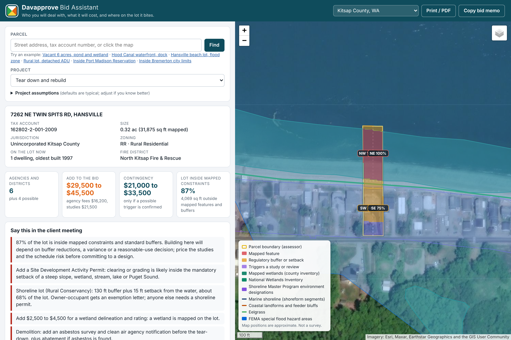

# Bid Assistant

Built November 12, 2026 on branch `claude/vibrant-archimedes-25i4ue`. Code and fee research date: November 12, 2026.

## What it is

A standalone feature for the first or second client meeting. Put in a Kitsap County parcel and a project type; get back:

1. **Who is involved**: every agency, district, tribe and consultant the project is likely to route through, each with the reason and the code section behind it.
2. **What to add to the bid**: permit fees and pre-construction studies as a low to high range, every line tied to a published fee schedule or a named market source.
3. **Where the lot is constrained**: mapped critical areas, standard buffers, shoreline and flood zones, as a share of the lot and by quadrant, drawn on an aerial map.
4. **What was permitted before**: county permit history, with lapsed and incomplete permits called out.

It is deliberately not the approval-dependency model. It reads maps and published code; it does not ingest a parcel's document history and nothing in it has to be hand-verified per parcel. The dependency graph research in `docs/research/` is untouched and remains the reference for the workflow feature.

## Run it

```sh
node bid-assistant/server.js          # then open http://localhost:8080
node bid-assistant/cli.js "614 Division St" --type new_sfr      # Markdown memo
node bid-assistant/cli.js 1248699 --type shoreline_structure --json
```



No install step and no dependencies beyond Node 18 or newer. The page is static files plus live requests from the browser to public map services, so it can be hosted anywhere. Leaflet 1.9.4 is vendored under `bid-assistant/vendor/`.

Hosting note: most map servers accept requests straight from the browser, but some state servers (Ecology in particular) refuse them intermittently. `server.js` includes a small relay, limited to the public data hosts the tool uses, that the page falls back to automatically. On a plain static host without that relay, an affected layer shows as "could not check" rather than failing silently.

Checks:

```sh
node tests/bid_assistant_geo.test.cjs       # geometry, no network
node tests/bid_assistant_engine.test.cjs    # rules and data integrity, no network
node tests/bid_assistant_live.cjs           # screens six real parcels; needs network
```

## How it is put together

| Piece | File | Job |
|---|---|---|
| Jurisdiction pack | `packs/wa-kitsap.js` | The only place that knows a county's map services and field names. Finds a parcel, lists layers, turns raw hits into neutral facts. |
| Screening | `lib/screen.js`, `lib/arcgis.js` | Runs every layer against one parcel. Reports `on_parcel`, `nearby`, `none` or `unknown` per layer. |
| Geometry | `lib/geo.js` | Distances, areas and a sampling grid that measures how much of the lot each constraint covers, by quadrant. |
| Rules | `rules/federal.js`, `rules/wa-state.js`, `rules/wa-kitsap.js` | 30 rules. Each restates a published trigger against the facts and the project, and names its citations and cost lines. |
| Engine | `lib/engine.js` | Evaluates rules, rolls findings up by agency, merges cost lines into base and contingency totals. |
| Research data | `data/citations.json`, `data/fees.json`, `data/agencies.json` | The citation library, cost lines and agency directory. `data/research/` holds the fuller research files they were built from. |
| Outputs | `app.js`, `lib/report.js`, `cli.js` | Web page, Markdown bid memo, command line. |

After editing anything under `data/`, run `node bid-assistant/tools/make_data.js` (if the research files changed) and `node bid-assistant/build.js`.

### Vocabulary

Every finding has a level and a basis. These follow the project rule of keeping documented requirements, proposed workflow steps and open agency questions apart.

| Level | Meaning | Where its costs go |
|---|---|---|
| required | A documented trigger is met by the project or by a feature mapped on the lot | Base estimate |
| likely | A mapped feature is close enough that the code calls for review; outcome depends on field work | Base estimate |
| possible | Depends on something maps cannot show | Contingency |
| unknown | The map layer could not be read | Shown as "could not check" |

Basis is `documented` (the cited text states the trigger), `workflow` (a recommended step, not itself a code requirement) or `confirm` (a question the agency must answer). The tool never says something is not required. A failed map request always surfaces as "could not check", never as a clean result.

### Map layers (29 for Kitsap)

Kitsap County GIS: parcels, assessor land and building tables, permit table, zoning, city limits, urban growth areas, reservation boundaries, fire and water districts, county sewer areas and mains, airport overlay, wetland inventory, streams with water type, geologic hazard areas, aquifer recharge areas, shoreline designations. Kitsap DCD environmental service: lakes, marine shoreline, shoreline armoring inventory, feeder bluffs, forage fish spawning, eelgrass. FEMA: special flood hazard areas. State and federal: National Wetlands Inventory, Ecology tribal lands, WSDOT state routes, DNR aquatic land ownership, DAHP archaeological risk model.

One layer needed special handling. The county publishes each geologic hazard class as a single county-wide polygon of about 34 MB, too large to download per parcel. The tool instead asks the server yes or no questions about progressively smaller rectangles across the lot (about 150 small requests) and treats the answer as a coarse grid, which is why hazard coverage is described as sampled.

## What was verified and what was not

Read this before showing numbers to a customer.

**Code citations: 116 entries, 105 with a quote machine-matched to fetched source text.**

- Kitsap County's official code host (ecode360) refuses automated access. No attempt was made to get around that. Kitsap sections were instead verified against the county's own published documents, and each citation records which one:
  - Title 19 critical areas: Ordinance 633-2024, effective April 1, 2025. This is the current update. It raised stream buffers (Type F 150 to 200 ft, Np and Ns 50 to 100 ft) and the wetland inventory distance (250 to 300 ft).
  - Title 22 shoreline: Ordinance 598-2021 as locally adopted, before Ecology's final approval.
  - Title 12 stormwater: Ordinance 599-2021. A 2026 update was before the Planning Commission; adoption status unknown.
  - Titles 11, 13, 14, 15, 16, 18, 21: the county's archived code snapshot dated December 2019.
  - ADU rules (17.415): the county's February 2026 handout and a 2025 staff report quoting the code.
- Because of this, most Kitsap citations link to the code's front page rather than the exact section. **A person should click through each Kitsap citation on ecode360 once** and record the deep link and any text change. The page shows "may be outdated" on every citation that came from an older copy.
- City code chapter numbers for Bremerton, Port Orchard, Poulsbo and Bainbridge Island are unverified. Inside a city the tool only routes to the city and says so.
- Neither tribe publishes a rule for who permits what on trust versus fee land. The tool raises it as a question to confirm and makes no determination.

**Agency fees: all from published schedules fetched November 12, 2026.** Kitsap DCD fee schedule revised June 3, 2026, with building valuation rates effective November 1, 2026; Kitsap Public Health 2026 schedule; county impact fee table revised September 24, 2026; county sewer charges effective January 1, 2026; state and federal fees from current WAC, RCW and CFR text. The building permit, impact fee and electrical figures are computed from published formulas; the county does not print worked totals. The county's own handout gives $7,899 for a 2,000 sq ft house under the previous valuation rates, against $8,293 computed here under the current ones.

The county fee schedule has **no line** for reviewing a wetland, habitat or geotechnical report, for buffer averaging, or for floodplain review. The tool says so and prices nothing for them. Ask DCD.

**Consultant costs are market ranges, not quotes.** Eleven have a named source, the strongest being a City of Bellevue on-call consultant price form from 2020 and a Kitsap builder's published figures. None is rated high confidence. Seven have no source at all and are shown as "placeholder, no source": septic design, geological assessment letter, civil engineering, elevation certificate, SEPA checklist, hydrogeological report and JARPA preparation. **These are the numbers most worth replacing with real quotes from local firms.**

**Maps.** Positions are approximate at lot scale. Buffers are measured from mapped lines, not from a located ordinary high water mark or a delineated wetland edge. Zoning setbacks, septic reserve areas, easements and slopes not on the hazard map are not in the constrained-area figure.

## Known limits and next steps

1. Click-through review of Kitsap citations on ecode360 (above).
2. Replace placeholder consultant ranges with quotes from three or four local firms per discipline.
3. Slope. The county hazard map does not say whether a hazard is landslide, erosion or seismic. USGS 3DEP elevation can give the share of a lot steeper than 15% and 30% in one request (tested, 7 to 17 seconds); the working request is recorded in `data/research/gis_endpoints.json`. Not yet wired in.
4. Soils. USDA soil survey data gives a septic suitability rating per lot; the working query is in the same file. Not yet wired in.
5. Cities. The four cities have their own fee schedules and code. Their map services are catalogued in the research file.
6. Basemap licensing. The aerial basemap is Esri World Imagery, which is fine for a prototype but needs an ArcGIS account for commercial use. The USGS topo option is public domain but stops at a coarser zoom.
7. Water purveyor. No layer says which water system serves a lot, so connection charges are an indicative range from Kitsap PUD and Silverdale Water.
8. Buildable envelope. The constraint grid is the natural input to the envelope map: add zoning setbacks from KCC 17.420 and the septic setbacks already in the citation library.

## Adding a county

State and federal rules are reused as they are. A new county needs:

1. A pack in `packs/` listing its map layers and mapping their fields to the same facts (`deriveFacts`). The statewide parcel layer and the county services for Mason, Jefferson, Pierce, King and Thurston are catalogued, with field notes, in `data/research/gis_endpoints.json`.
2. A rule file in `rules/` for the county code, with its citations added to the library.
3. Its fee schedule lines in `data/fees.json`.

The geometry, screening, engine, page and memo do not change.
