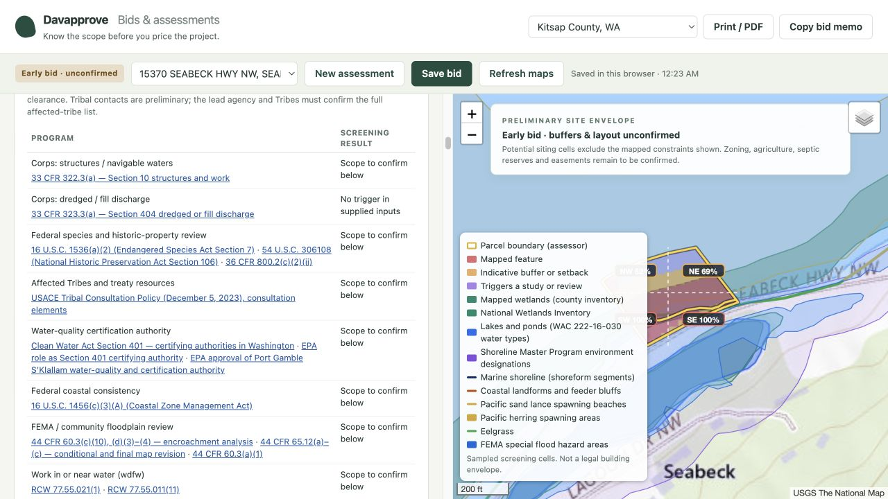
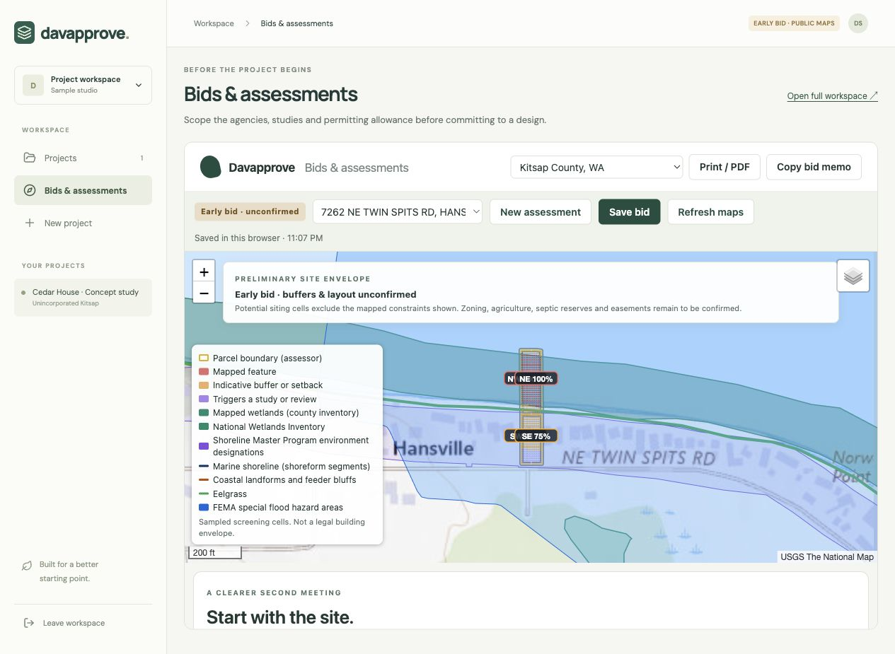
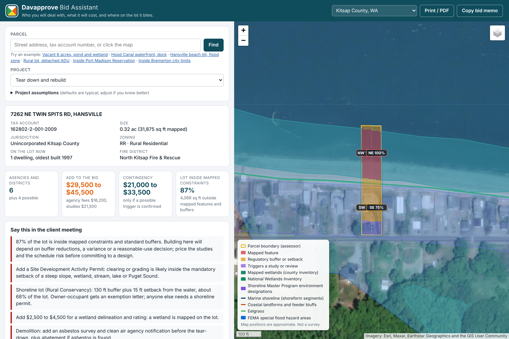

# Bid Assistant


## November 23, 2026: hosted private beta

The hosted estimate, detailed report and homeowner view require a beta invitation. The Cloudflare Worker runs the rule engine and holds the county source packs. The browser renders parcel-specific results and applies custom bid allowances to the returned cost lines. Saved snapshots can be reopened and recalculated server-side. The standalone Node tool remains available for local development. See [private beta operations](operations.md#private-beta) for invitations, deployment, the MCP tool and anonymous county-level metrics.

## Pierce and Kirkland update — November 23, 2026

Pierce is available in both the address-first estimate and full bid report. County and city fee profiles cover Tacoma, Lakewood, Puyallup, University Place, Bonney Lake, Gig Harbor, Fife, Sumner and shared Auburn coverage. Independent tribal, electrical-territory, military, health and volcanic-hazard checks supplement existing federal/state screening. Kirkland's published building/planning schedules and impact-fee PDF now replace its quote-only placeholders. See [source review, limits and verification](PIERCE_KIRKLAND_SOURCES.md).

Regional maps remain provisional footprint screens with unresolved setbacks/buffers. Approximate county examples and conditional city charges are labeled as allowances; unsupported scopes stay quote-needed. User price overrides and original source links are preserved. No permit documents or personal parcel fields are fetched.

## Estimate pages and report gate — November 23, 2026

The beta front door is a basic estimate (see [UX design brief](UX_DESIGN_BRIEF.md)). `lib/quick.js` runs the same screening, constraint and rule steps as the workspace (`analyze`) and reduces the result to the ungated summary (`summarize`): base and possible ranges from `Engine.evaluate`, counts of agencies and quote-needed items, unread map layers and captured scope. It carries no line items, code excerpts or citations. The workspace now uses its coverage rule (`incomplete`) as well, so the two cannot disagree about a clean result.

The workspace accepts a project brief in the fragment (`#county=…&parcel=…&type=…&project=<JSON>`); only fields known to `normaliseProject` take effect. Systems and upgrades without checked rules (`BidQuick.SCOPE_ITEMS`: solar, heat pump, EV charger and others) are saved with the bid as `scope_items` and shown as "not separately estimated", excluded from totals. Researching and sourcing those permits is open work.

The hosted static page no longer honors `?public=1`: the detailed report opens inside the signed-in workspace. This is a product gate, not a security boundary, because the engine and source library are public static files.

## Account-backed bids — November 15, 2026

Saved bids now persist in Supabase with creator and explicit collaborator access, rather than browser-local storage. This supersedes the browser-local behavior described in the historical release notes below. Signed-out/sample screening cannot read or save account bids. The authenticated application shell handles storage; the assessment iframe never receives session tokens. Full-workspace links open that same shell.

Creators can grant editor or read-only access to an existing confirmed account by email, or revoke it, using **Collaborators**. No invitation email is sent; the recipient signs in to see shared work. Projects have the equivalent **Project collaborators** control. Existing project ownership and memberships are preserved. Sharing and grants are enforced in Postgres, not by hiding UI controls.

Old browser drafts are not assigned automatically. **Import previous browser bids** asks the signed-in user to confirm ownership, then imports the stored snapshots. Browser copies are removed only after every import succeeds; partial failures preserve them for retry. Bids remain distinct from approval projects and never become permit approvals. Concurrent saves use version checks; reopen a conflicting bid before saving again. Account changes unmount the frame and discard pending results. Reopening saved snapshots does not write them, including for read-only collaborators.

Validation covers creator/collaborator/outsider/anonymous access, owner-only sharing, revocation, stale-write rejection, frame origins, account changes, explicit legacy import and existing screening/export behavior. SQL tests run in CI with the other RLS assertions.


Built November 12, 2026 on branch `claude/vibrant-archimedes-25i4ue`. Code and fee research date: November 12, 2026.

## November 14, 2026: independent agency coverage

The bid engine now runs independent tribal, state and federal program checks from the **proposed activity**, land-status assumptions and public agency layers. County permit summaries are not consulted by these rules. No document import, OCR, title parsing or approval reconciliation was added.

- **Corps:** Section 10 structures/work in navigable water and Section 404 dredged/fill discharge are separate rules. Marine and freshwater projects are screened; a dock does not automatically trigger Section 404. A wetland-fill question no longer depends on how much of the parcel is constrained. Missing aquatic maps remain unresolved.
- **Tribes:** independent state tribal-land results are retained even when county boundaries fail, including additional tribal names. Tribal land permission, treaty/cultural consultation and water-quality certification have separate roles. Suquamish, Port Gamble S’Klallam and Skokomish are sourced regional starting contacts; **this is not a complete affected-tribe list**. The federal lead and Tribes must establish the full list for the actual waterbody and activity. Unrecognized names are never silently mapped to Suquamish or Port Gamble. Reservation, trust/fee and zoning labels alone do not decide permitting authority.
- **Water-quality certification:** route to Ecology, an authorized Tribe or EPA according to the work/discharge location; unknown or conflicting jurisdiction keeps alternatives open. EPA’s published Port Gamble S’Klallam approval is attached to that candidate route. Certification coverage and conditions still require confirmation; the system does not infer authority from fishing rights alone.
- **DNR / WDFW:** freshwater and marine aquatic work retain independent land-use and hydraulic-permit checks. DNR ownership is evaluated at the proposed footprint, not inferred from a nearby polygon or lack of a map hit. Recreational rent-free use does not waive other permits.
- **Floodplain:** independent FEMA data and reported floodplain activities trigger local-administration, hydraulic/no-rise and conditional-map-revision checks. Reported encroachment and rise exceeding the cited federal thresholds produce a CLOMR requirement for the supplied scenario. Unknown rise is not zero; a supplied no-rise result is not certified by this tool. Community standards may be stricter, and a CLOMR is not local construction permission.
- **Other federal roles:** species and historic-property review follow a potential federal permit or reported federal action. Consultation with both wildlife agencies is not automatically asserted. Coastal consistency remains separate from water-quality certification.
- **Stormwater / environmental review:** common-plan development is screened even below the individual-site disturbance threshold. EPA is considered for Indian Country and federal operators instead of automatically applying Ecology’s price. SEPA lead identity is not assumed to be the county on city, tribal or federal projects.

The optional **Agency scope** accordion supplies water setting, discharge, navigability, jurisdiction, flood footprint/rise, floodway adoption and federal/common-plan assumptions. A parcel without a floodway hit does not establish that no floodway was adopted for the river reach. These are reported bid inputs, not agency decisions. Saved drafts and copied memos preserve them; older drafts default missing answers to unknown. The **Agency checks beyond county records** panel lists the programs screened, their sources and whether follow-up remains. “No trigger in supplied inputs” is explicitly not a clearance.

Every new finding retains sources, source-check date, jurisdiction, work stage and an empty approved revision. New hydraulic analysis, FEMA map review, certification support and EPA stormwater price gaps are **quote needed**, excluded from priced totals until the user supplies an allowance. Alternative certifiers share one preparation allowance rather than duplicating that study.

Source records are in `data/citations.json`, `data/fees.json` and `data/agency-routing.json`; the contact shortlist is a proposed workflow, not a treaty-boundary database. Direct DNR PDF retrieval was refused, so that record discloses use of official indexed text and is not marked quote-verified. The earlier county-code library has not been re-certified. All newly reviewed sources are dated **November 14, 2026**.

Validation covers county outages, explicit fill without map hits, no-fill marine docks, freshwater navigability, state/tribal/EPA routing, unidentified tribal names, conflicting jurisdiction, common-plan stormwater, FEMA threshold boundaries, unpriced costs, saved scope, legacy defaults and memo provenance. Live browser verification used the Hood Canal dock example and saved-bid reopening. Memo generation and delivery to the clipboard API were verified in the DOM test; the browser automation clipboard reader returned an older memo, so live clipboard contents were not independently verified. No new parcel services or document fetches were added.



CLI examples accept the same scope inputs, such as `--waterbody freshwater --fill-discharge no --land-status tribal --common-plan` and `--flood-work yes --floodway-work yes --flood-rise-ft 0.1`. These values describe a scenario, not a verified legal conclusion.

## November 13, 2026: bid workspace integration

The beachhead is a **bid assessment**, independent of the records/approval workflow. The local application and standalone research branches were combined on `codex/bid-assessment-workspace`; the original project, private records, site-envelope and workflow implementations remain available.

- The application sidebar has **Bids & assessments**. The welcome screen also links directly to the public screening tool, without creating a project or starting document discovery, OCR, AI processing or a fact-review queue.
- Saved assessments retain the parcel map snapshot, project assumptions, cost overrides, quote/exclusion notes and assessment title. They are explicitly **browser-local**, not authenticated team storage. A saved bid opens without fetching documents or re-querying maps; **Refresh maps** rechecks public sources while retaining the bid's assumptions and allowances. Clearing browser storage removes these drafts. The copied memo is a separate portable record.
- The map says **Early bid · buffers & layout unconfirmed**. Potential siting cells are distinguished from mapped features, indicative buffers and study areas. Incomplete maps, city coverage and uncertain jurisdiction make remaining cells gray and unresolved. Cells are a sampling visualization, not a surveyed boundary or a legal buildable-area determination.
- Permit fees, professional studies, impact fees and listed connection charges are priced separately. Editable ranges and exclusion notes propagate to the subtotal, agency details and memo. Reset restores the reference price; exclusions never remove requirements. Invalid or reversed ranges cannot change totals. Small published fees remain visible instead of rounding to zero.
- Unsourced consultant placeholders are now **Quote needed** and are excluded from priced subtotals until a user supplies an allowance. Published local professional estimates were refreshed from [Studio Kamppari's Kitsap fee guidance](https://www.studiokamppari.com/articles/soft-costs), checked November 13, for geotechnical reports, geological assessments, septic design, mitigation planning and surveys. Shoreline mitigation remains a scope proxy, explicitly identified. No inflation factor or firm quote is invented.
- Expired/incomplete permit summaries prompt a **reuse check**, citing [DCD1014POL](https://www.kitsap.gov/dcd/Documents/Reactivation%20and%20Extension%20Policy.pdf). The issuing agency must decide reactivation, revision, reuse or replacement. No automatic credit or fresh-application determination is made from table status alone.
- Failed/truncated sources remain visible. Unconfirmed jurisdiction suppresses county-specific permitting prices and buffer calculations. Owner/applicant names and free-text permit project names are not requested; DNR queries only return state-land classifications, not owner identities.



### Running the integrated application

```sh
cd web
npm install                 # only if dependencies are absent
npm run dev
```

The `predev` and `prebuild` scripts copy an allowlisted set of screening assets into `web/public/bid-assistant/`. These generated copies are ignored; edit `bid-assistant/`, then restart development or run `node scripts/sync_bid_assets.mjs` from the repository root. Production builds include the standalone route at `/bid-assistant/index.html`. No production deployment was made in this change. On a static host this route uses public GIS CORS; the optional relay is available through the standalone server, not automatically through the application host.

### Verification and remaining scope

Validated: production web build, the existing frontend suite (including navigation to bids and back without changing project revision), engine/geometry regression tests, saved-draft tests, synthetic DOM integration and live Hansville parcel screening. Browser checks exercised a quote edit, memo export and saved-bid reopening. Synthetic tests cover missing map responses, quote gaps, invalid ranges, exclusion provenance, storage quota/corruption and failed lookups. These checks validate software behavior, not all underlying law or published prices.

Pricing covers **unincorporated Kitsap and selected fees for all four incorporated cities** (see the November 14 fee updates below). Municipal allowances use city schedules, with separate quote-needed items for unresolved scope. City buffer geometry remains unmodelled. Agricultural/resource-land buffers, full zoning setbacks/allowed use, recorded easements/plat conditions, septic reserves and legal lot status remain explicit confirmation items; they are not geometrically resolved by this map. Some older code sources and consultant estimates still need professional review. Browser-local saving is intentionally separate from the private project's revision/approval model; team synchronization and converting a bid to a project are not implemented.

Additional checks (the DOM integration test uses the web checkout's installed `jsdom`):

```sh
node tests/bid_assistant_drafts.test.cjs
node tests/bid_assistant_ui.test.cjs
cd web && npm test && npm run build
```

## What it is

A standalone feature for the first or second client meeting. Put in a Kitsap County parcel and a project type; get back:

1. **Who is involved**: screened agencies, districts, tribal contacts and consultants the project may involve, each with the reason and the code section behind it.
2. **What to add to the bid**: permit fees and pre-construction studies as a low to high range, every line tied to a published fee schedule or a named market source.
3. **Where the lot is constrained**: mapped critical areas, standard buffers, shoreline and flood zones, as a share of the lot and by quadrant, drawn on an aerial map.
4. **What may need to be redone**: county permit summaries, with lapsed and incomplete records flagged for agency confirmation of reuse, revision or reactivation.

It is deliberately not the approval-dependency model. It reads maps and published code; it does not ingest a parcel's document history and it does not require bulk manual fact verification to produce a bid screen; flagged site-specific questions still need confirmation before a fixed bid. The dependency graph research in `docs/research/` is untouched and remains the reference for the workflow feature.

## Run it

```sh
node bid-assistant/server.js          # then open http://localhost:8080
node bid-assistant/cli.js "614 Division St" --type new_sfr      # Markdown memo
node bid-assistant/cli.js 1248699 --type shoreline_structure --json
```



No install step and no dependencies beyond Node 18 or newer. The page is static files plus live requests from the browser to public map services, so it can be hosted anywhere. Leaflet 1.9.4 is vendored under `bid-assistant/vendor/`.

Hosting note: most map servers accept requests straight from the browser, but some state servers (Ecology in particular) refuse them intermittently. `server.js` includes a small relay, limited to the public data hosts the tool uses, that the page falls back to automatically. On a plain static host without that relay, an affected layer shows as "could not check" rather than failing silently.

Checks:

```sh
node tests/bid_assistant_geo.test.cjs       # geometry, no network
node tests/bid_assistant_engine.test.cjs    # rules and data integrity, no network
node tests/bid_assistant_live.cjs           # screens six real parcels; needs network
```

## How it is put together

| Piece | File | Job |
|---|---|---|
| Jurisdiction pack | `packs/wa-kitsap.js` | The only place that knows a county's map services and field names. Finds a parcel, lists layers, turns raw hits into neutral facts. |
| Screening | `lib/screen.js`, `lib/arcgis.js` | Runs every layer against one parcel. Reports `on_parcel`, `nearby`, `none` or `unknown` per layer. |
| Geometry | `lib/geo.js` | Distances, areas and a sampling grid that measures how much of the lot each constraint covers, by quadrant. |
| Rules | `rules/federal.js`, `rules/wa-state.js`, `rules/wa-kitsap.js` | 36 rules. Each restates a published trigger against the facts and the project, and names its citations and cost lines. |
| Engine | `lib/engine.js` | Evaluates rules, rolls findings up by agency, merges cost lines into base and contingency totals. |
| Research data | `data/citations.json`, `data/fees.json`, `data/agencies.json` | The citation library, cost lines and agency directory. `data/research/` holds the fuller research files they were built from. |
| Outputs | `app.js`, `lib/report.js`, `cli.js` | Web page, Markdown bid memo, command line. |

The editable runtime source of truth is `data/citations.json` and `data/fees.json`. After editing them, run `node bid-assistant/build.js`. The older research transformer (`tools/make_data.js`) can overwrite subsequent curated edits; use it only when intentionally reconciling changed research with the runtime data.

### Vocabulary

Every finding has a level and a basis. These follow the project rule of keeping documented requirements, proposed workflow steps and open agency questions apart.

| Level | Meaning | Where its costs go |
|---|---|---|
| required | A documented trigger is met by the project or by a feature mapped on the lot | Base estimate |
| likely | A mapped feature is close enough that the code calls for review; outcome depends on field work | Base estimate |
| possible | Depends on something maps cannot show | Contingency |
| unknown | The map layer could not be read | Shown as "could not check" |

Basis is `documented` (the cited text states the trigger), `workflow` (a recommended step, not itself a code requirement) or `confirm` (a question the agency must answer). The tool never says something is not required. A failed map request always surfaces as "could not check", never as a clean result.

### Map layers (29 for Kitsap)

Kitsap County GIS: parcels, assessor land and building tables, permit table, zoning, city limits, urban growth areas, reservation boundaries, fire and water districts, county sewer areas and mains, airport overlay, wetland inventory, streams with water type, geologic hazard areas, aquifer recharge areas, shoreline designations. Kitsap DCD environmental service: lakes, marine shoreline, shoreline armoring inventory, feeder bluffs, forage fish spawning, eelgrass. FEMA: special flood hazard areas. State and federal: National Wetlands Inventory, Ecology tribal lands, WSDOT state routes, DNR aquatic land ownership, DAHP archaeological risk model.

One layer needed special handling. The county publishes each geologic hazard class as a single county-wide polygon of about 34 MB, too large to download per parcel. The tool instead asks the server yes or no questions about progressively smaller rectangles across the lot (about 150 small requests) and treats the answer as a coarse grid, which is why hazard coverage is described as sampled.

## What was verified and what was not

Read this before showing numbers to a customer.

**Code citations: 132 entries.** The original research reported 105 machine-matched quotes. The November 13 update adds a directly checked reactivation-policy excerpt and an explicitly unverified code-applicability pointer for site restrictions; it does not re-certify the earlier library.

- Kitsap County's official code host (ecode360) refuses automated access. No attempt was made to get around that. Kitsap sections were instead verified against the county's own published documents, and each citation records which one:
  - Title 19 critical areas: Ordinance 633-2024, effective April 1, 2025. This is the current update. It raised stream buffers (Type F 150 to 200 ft, Np and Ns 50 to 100 ft) and the wetland inventory distance (250 to 300 ft).
  - Title 22 shoreline: Ordinance 598-2021 as locally adopted, before Ecology's final approval.
  - Title 12 stormwater: Ordinance 599-2021. A 2026 update was before the Planning Commission; adoption status unknown.
  - Titles 11, 13, 14, 15, 16, 18, 21: the county's archived code snapshot dated December 2019.
  - ADU rules (17.415): the county's February 2026 handout and a 2025 staff report quoting the code.
- Because of this, most Kitsap citations link to the code's front page rather than the exact section. **A person should click through each Kitsap citation on ecode360 once** and record the deep link and any text change. The page shows "may be outdated" on every citation that came from an older copy.
- Older city code chapter references remain unverified and are retained as research records, but are no longer asserted in the city-routing finding. The municipal updates verify selected official fee schedules and published application guidance, not full city code applicability or city buffer geometry.
- The complete tribal/local permitting split is not established by the checked sources. Port Gamble S’Klallam publishes environmental and certification material, and EPA confirms its certification authority; those sources do not resolve every parcel-specific land-use question.

**Agency fees: all from published schedules fetched November 12, 2026.** Kitsap DCD fee schedule revised June 3, 2026, with building valuation rates effective November 1, 2026; Kitsap Public Health 2026 schedule; county impact fee table revised September 24, 2026; county sewer charges effective January 1, 2026; state and federal fees from current WAC, RCW and CFR text. The building permit, impact fee and electrical figures are computed from published formulas; the county does not print worked totals. The county's own handout gives $7,899 for a 2,000 sq ft house under the previous valuation rates, against $8,293 computed here under the current ones.

The county fee schedule has **no line** for reviewing a wetland, habitat or geotechnical report, for buffer averaging, or for floodplain review. The tool says so and prices nothing for them. Ask DCD.

**Consultant costs are market ranges, not quotes.** Thirteen lines have named sources, including the local architect guidance refreshed November 13, the City of Bellevue on-call form from 2020 and other published market references. None is rated high confidence. Five have no source: civil engineering, elevation certificate, SEPA checklist, hydrogeological report and JARPA preparation. Their legacy placeholder values remain in the research records but the UI and memo show **Quote needed**, excluding them from totals until a user enters a range. Source dates and scope limitations remain visible. Local consultant quotes are still preferable.

**Maps.** Positions are approximate at lot scale. Buffers are measured from mapped lines, not from a located ordinary high water mark or a delineated wetland edge. Zoning setbacks, septic reserve areas, easements and slopes not on the hazard map are not in the constrained-area figure.

## Known limits and next steps

1. Click-through review of Kitsap citations on ecode360 (above).
2. Replace placeholder consultant ranges with quotes from three or four local firms per discipline.
3. Slope. The county hazard map does not say whether a hazard is landslide, erosion or seismic. USGS 3DEP elevation can give the share of a lot steeper than 15% and 30% in one request (tested, 7 to 17 seconds); the working request is recorded in `data/research/gis_endpoints.json`. Not yet wired in.
4. Soils. USDA soil survey data gives a septic suitability rating per lot; the working query is in the same file. Not yet wired in.
5. Cities. The four cities have their own fee schedules and code. Their map services are catalogued in the research file.
6. Basemap licensing. USGS topo is the default public-domain basemap and stops at a coarser native zoom. Optional Esri aerial imagery remains subject to Esri commercial licensing terms.
7. Water purveyor. No layer says which water system serves a lot, so connection charges are an indicative range from Kitsap PUD and Silverdale Water.
8. Buildable envelope. The constraint grid is the natural input to the envelope map: add zoning setbacks from KCC 17.420 and the septic setbacks already in the citation library.

## Adding a county

State and federal rules are reused as they are. A new county needs:

1. A pack in `packs/` listing its map layers and mapping their fields to the same facts (`deriveFacts`). The statewide parcel layer and the county services for Mason, Jefferson, Pierce, King and Thurston are catalogued, with field notes, in `data/research/gis_endpoints.json`.
2. A rule file in `rules/` for the county code, with its citations added to the library.
3. Its fee schedule lines in `data/fees.json`.

The geometry, screening, engine, page and memo do not change.

## November 14: Bainbridge city fee coverage

The city-routing finding previously contained no cost rows, leaving electrical fees as a misleadingly small priced subtotal. Bainbridge now has separate building permit, building plan-check, planning/engineering review, administrative, residential state surcharge, transportation impact and grading allowances. All rates and valuation bands are stored in `data/fees.json`, with the official 2026 city schedule and transportation rate table attached and checked November 14.

Enter **Estimated city permit valuation ($)** and the prior-planning-review answer in Project assumptions. Building and review fees remain explicitly unpriced until a valuation is supplied; the city's adopted ICC valuation can exceed the entered contractor/bid value. Unknown prior review carries a zero-to-full planning-review range; reported prior review removes that specific Bainbridge allowance subject to city confirmation. It does not remove unrelated land-use applications or other cities' building review. Inputs persist with drafts and appear in the memo. Existing per-line overrides remain available.

Mapped critical areas and shoreline jurisdiction add conditional city application allowances. These are alternative minor/major or exemption/administrative-review ranges, not cumulative permits or ceilings. Variances, reasonable-use exceptions, third-party review deposits and consolidated-review adjustments require separate confirmation. Mechanical/plumbing, additional land-use scope and utility connection totals are visible editable quote-needed rows. No universal land-use permit is asserted for every new house. Replacement-home impact fees are not automatically charged. Other cities and city buffer geometry are unchanged.

Validation: live public screening matched 602 Alder Ave NE to Bainbridge Island (parcel key 1517051); no owner or applicant information was requested. Engine tests cover published valuation bands, missing valuation, prior review, impact administration, grading, jurisdiction isolation and replacement homes. Geometry, draft and DOM tests cover saving/reopening the new inputs, memo provenance and editable city pricing. The live parcel screening is not an agency fee quote or confirmation of its approved design.

## November 14: remaining municipal coverage

The [county jurisdiction map index](https://www.kitsap.gov/dcd/Pages/Community_Development_Maps.aspx) identifies Bainbridge Island, Bremerton, Poulsbo and Port Orchard as incorporated cities. **Silverdale and Kingston are unincorporated UGAs** and retain county pricing. City-limit GIS results select the schedule; neither situs city nor an adjacent UGA name is used as a substitute. Failed, truncated, unnamed, unrecognized or conflicting city-boundary responses leave jurisdiction unresolved and withhold local permit calculations. This is a map screening, not a legal boundary determination.

The unincorporated [Poulsbo Urban Transition Area](https://www.kitsap.gov/dcd/Pages/Poulsbo_Urban_Transition_Area.aspx) has a specific county-code reference to Poulsbo development standards. The report now calls out that review without automatically charging incorporated-city fees. Other tribal, state, federal and utility checks remain independent of county permit history.

| City | Newly modeled allowances | Official sources checked November 14, 2026 |
| --- | --- | --- |
| Poulsbo | Valuation-based building and plan review, technology, conditional planning/design and minor/full site-plan review including engineering, critical-area and shoreline application alternatives, current new-home park/traffic impacts, conditional city utility capacity | [Building Table 1-A](https://poulsbo.gov/wp-content/uploads/2025/02/BLDG-FEES_CURRENT-2025.pdf), [planning](https://poulsbo.gov/wp-content/uploads/2025/02/Fee-Schedule_2025-Updates_Clean-Copy-for-Web.pdf), [engineering](https://poulsbo.gov/wp-content/uploads/2025/07/Engineering-Fee-Schedule-2025-updated-7-17-25-final-1.pdf), [residential charges](https://poulsbo.gov/building-department/) |
| Port Orchard | Building and plan review, per-application technology, new-home transportation/bedroom-scaled parks/area-scaled schools, disturbance and drainage formulas, ADU review, conditional critical-area and shoreline applications | [Resolution 022-25](https://www.portorchardwa.gov/DocumentCenter/View/550), [March 2026 residential impact rates](https://www.portorchardwa.gov/DocumentCenter/View/548) |
| Bremerton | Building and plan review, technology, new-home energy review, grading by volume, conditional site-development and shoreline fees; hourly critical-area review explicitly unpriced | [2026 Table C and Exhibits 1–4](https://www.bremertonwa.gov/DocumentCenter/View/98/Rates-Fees-PDF), [site-development application / BMC 20.58.090](https://www.bremertonwa.gov/DocumentCenter/View/1740/Site-Development-Permit-PDF) |

All new city building estimates include the [residential state building-code surcharge](https://app.leg.wa.gov/rcw/default.aspx?cite=19.27.085). [L&I's municipal inspection list](https://www.lni.wa.gov/licensing-permits/electrical/electrical-permits-fees-and-inspections/city-electrical-permits-inspections) does not include any Kitsap city; the separate L&I electrical allowance remains for normal state/local projects.

These are research-date schedules and **selected early-bid allowances, not complete municipal quotes**. Fee schedules establish prices, not parcel-specific triggers. Separate land-use review is conditional rather than assumed for every house. Trade fixtures, utility providers/credits, review hours, hearings, refundable deposits, civil design, special approvals and some impact totals still require a quote. Short plats and special structures need project-specific application scope; no universal total is claimed. Existing mapped-feature professional-study allowances remain alongside city fees. City capacity charges are conditional and exclude meter/construction/extension costs; they are not proof of service availability.

Poulsbo has conflicting official school guidance: its building page requests school payment but links a **county** impact table, while its [planning update](https://poulsbo.gov/ped-2026-impact-fee-update/) says school mitigation is no longer collected. This remains a visible confirmation item rather than importing county prices. Signed [fire ordinance 2026-07](https://poulsbo.gov/wp-content/uploads/2026/06/2026-07-Fire-Impact-Fee-Update.pdf) and [park ordinance 2026-08](https://poulsbo.gov/wp-content/uploads/2026/06/2026-08-Park-Impact-Fee-Update.pdf) become effective January 1, 2027; fire collection additionally requires an executed interlocal agreement. Future timing/rate adjustments are explicitly unpriced, and customers should replace current baseline rows with the city calculation. The city update page's link labels are inconsistent with their document contents; the underlying ordinances were inspected.

Port Orchard new construction uses its adopted IBC valuation data; a supplied contractor price is provisional. ADU impact caps need principal-home area/bedroom data, so ADU impacts remain quote-needed instead of inheriting full detached-home fees. Replacement homes are not automatically charged full new-home impacts. Bremerton's commercial/multifamily site-plan fee is not applied to single-family homes, and hourly critical-area review is not converted to an invented total.

Data remains in `citations.json` / `fees.json`, with source dates attached to findings, fee rows and the memo. No document ingestion, owner/applicant fields, new approvals or dependency-graph changes were added. Regression checks cover all cities, UGA routing, valuation boundaries, impact caps, grading/drainage thresholds, missing inputs, uncertain boundaries, tribal/federal exceptions, price overrides, memo sources and DOM rendering.

## November 15, 2026: King and Skagit beta packs

The county selector now supports King and Skagit without importing permit histories. County GIS resolves the tax parcel and municipal boundary; a postal city is not jurisdiction evidence. Unincorporated Vashon uses King County. Unincorporated Skagit communities use the county. A mapped city without a transcribed schedule stays city-routed with **quote needed**, rather than inheriting county prices. Failed, blank, conflicting or truncated boundary evidence withholds county/city fee calculations. Tribal land and uncertain land status retain independent routing and do not receive both full local fee schedules.

### Selected fee coverage

The checked sources and formula parameters are in the master citation and fee JSON, with `region` tags. Check date: **2026-11-15**. These are selected permit components, never a complete fixed-price approval package.

| Jurisdiction | Transcribed bidding components | Material remaining scope |
| --- | --- | --- |
| Unincorporated King | Custom-home review and area-based inspection; site review; ADU; application screening; conditional sprinkler review | Other building types, impact/utility/trade scope and site-specific reviews |
| Seattle | Building/plan review; conditional MUP allowance using the published land-use hourly rate | Actual MUP category/hours, intake/notices, civil/trade and service charges |
| Bellevue | Building/plan review, new-dwelling adjustment, operation fee and residential planning review | Impact/service/trade and special site reviews |
| Redmond | Building/plan review, technology, selected planning/engineering/fire reviews | Impact/service and project-specific specialist reviews |
| Sammamish | Building/plan review, technology, selected planning and critical-area review | Impact/service and additional review scope |
| Kent | Building permit; critical-area delineation review range | Plan review and other civil/land-use charges remain quote-needed |
| Renton | Building/plan review, technology, planning/engineering percentage components | Separate trades, impact/service and additional reviews |
| Federal Way | Building/plan review, automation minimum/percentage and digitization | Confirm automation assessment base; planning/impact/service scope |
| Auburn | Building/plan review (published technology already included) | Planning/civil/impact/service scope |
| Shoreline | Building/plan review, technology, zoning minimum and conditional civil-review minimum | Actual additional hours and service/impact scope |
| Kirkland | City routing, municipal electrical authority and linked official source directory | Building/planning totals remain quote-needed: primary fee text was inaccessible; no secondary rate was silently treated as an adopted schedule |
| Unincorporated Skagit | Building/plan review/technology; zoning/fire/public-works review; drainage/grading bands; flood fee | District, service/impact and specialist scope |
| Mount Vernon | Building/plan review/technology from currently linked June 2025 handout | City warns online fees may lag; confirm current schedule and planning/civil charges |
| Burlington | Building/plan review and application fee; planning; conditional site/driveway review | Utility/impact and additional review scope |
| Sedro-Woolley | Building/plan review; selected home/ADU planning fees | Civil/service/impact and special reviews |
| Anacortes | Building/plan review; selected July 2026 planning, ADU and shoreline fees | Actual planning category and service/impact scope |

Municipal electrical inspectors are routed independently of county permitting. Skagit demolition goes to Northwest Clean Air Agency, not PSCAA. County health authorities handle septic feasibility and water availability; the Skagit water check links Ecology's basin restrictions. Regional tribal contacts are **starting contacts, not a complete affected-Tribe list or a finding that each Tribe must approve**. The existing Corps, FEMA, EPA, Ecology, DNR, WDFW, DAHP and other independent activity checks remain active. A mapped Skagit dike/drainage district generates a separate review and quote item, including inside cities.

The ecologist allowance uses a consultant's published rate for both counties and an explicitly assumed hours range. Seattle's land-use range similarly combines the official hourly rate with an editable assumed review duration. Neither is an agency/consultant quote or a maximum. Regional geotechnical studies remain quote-needed rather than reusing Kitsap market prices. All allowances retain their sources after a user override. Impact, utility and trade gaps are explicitly excluded from priced subtotals until the user supplies numbers.

### Maps and legal limits

Each pack queries a small set of county and independent state/federal layers, with bounded concurrency and eight-second request timeouts (one retry). No owner/applicant fields, permit documents, OCR or status reconciliation are requested. Skagit and King address abbreviations are normalized for their different situs formats. Missing or unmatched assessor addresses can be located by parcel ID or clicking the map.

The map shows parcel and available inventory footprints, with **all regional siting cells unresolved**. County/city regulatory buffers, ordinary setbacks and a surveyed buildable envelope have not been implemented for these packs. No empty inventory or failed request is displayed as a buildable clearance. In particular:

- King reports updated critical-area rules effective February 18, 2026 outside shoreline jurisdiction, with vesting dependent on the application and any effective critical-area determination. The linked guidance explains why an old report does not automatically preserve old buffers.
- Skagit reports a July 2026 hearings-board decision concerning riparian buffers and a pending amendment process. Proposed changes are not adopted rules; the county finding attaches the current notice and code review source.
- Agricultural/resource zoning, shoreline rules, dike/drainage restrictions, water availability and project-specific studies can materially reduce the usable area. GIS coverage is incomplete and city zoning layers have not all been integrated.

This is beta bidding coverage, not an exhaustive municipal code implementation or a production permit-authorizing engine. Existing approval/workflow logic and Kitsap screening are retained.

### Storage and retrieval

`data/citations.json`, `fees.json` and `agencies.json` remain the reviewable source of truth. A regional record has a globally unique ID and a `region` tag. `data/regions/<county>.json` declares parcel/boundary endpoints, allowlisted fields, municipality profiles, fee triggers, contact routing, check/review dates and explicit coverage limits. Add a county by adding data, not another copy of the rule engine.

`node bid-assistant/build.js` validates references, duplicate IDs, supported formula methods, fee ranges/bands, trigger names and tribal routing. It emits:

1. The existing shared/Kitsap `data.js`, with a content revision.
2. A small `regions.js` manifest.
3. One content-addressed JSON supplement per county under `data/bundles/`. The hash includes the shared-data revision, so shared evidence updates invalidate the dependent county revision too.

The browser fetches only the selected supplement, coalesces concurrent requests, memoizes successful loads and permits retry after failure. A mismatched shared/county revision is rejected with a refresh instruction. Cloudflare serves hashed supplements with immutable cache headers; the manifest and shared data must revalidate. Initial supplements are roughly 40–55 KB uncompressed. Public regulatory references do not need per-parcel database queries or a backend round trip. Existing private project/records storage is unchanged.

Saved bids retain the county and reference revision with their map snapshot. Reopening selects the correct pack, recalculates against the loaded library, preserves user quotes and warns when the source revision changed. It does not rerun maps automatically. Sources have a review horizon and an overdue warning; the warning does not certify current prices. Before publishing annual schedules, review effective dates, regenerate, test and retain previously published hashed supplements for clients still holding an older manifest. Do not edit a published hashed file in place.

### Verification

`tests/bid_assistant_regions.test.cjs` covers pack isolation, one-fetch caching, load failure/retry, shared/county revision mismatch, unknown/tribal/boundary routing, uppercase municipal names, all supported project types, representative price fixtures and every valuation-band endpoint, conditional versus base allowances, district involvement, safe query fields and address normalization. It runs in frontend CI. Synthetic DOM tests cover switching counties, screening, saving/reopening regional drafts, source revisions and editable quotes. Existing engine, geometry, drafts and report checks continue to run.

`node tests/bid_assistant_regions_live.cjs` is an opt-in public GIS smoke test, kept out of deterministic CI. It checks city/unincorporated routing for twelve parcels across both counties without requesting owner data. Live civic-site screening in Seattle and Mount Vernon completed in approximately 17 seconds during verification: local layers responded quickly, while FEMA timed out and was correctly retained as **unknown**. This is an observed sample, not a latency guarantee or legal verification. Direct service CORS was checked for the new county hosts.

CLI example: `node bid-assistant/cli.js 0942000810 --pack wa-king --type new_sfr --construction-value 550000`.

## November 16, 2026: assessment publisher and parcel-scale exports

The **Bid owner / agency** field identifies the business preparing the assessment, not the landowner. New integrated workspaces default it from the signed-in account's business/company/organization/agency metadata when supplied. It is editable per assessment and saved in browser-local drafts as `agency_name`. Older drafts reopen with an unspecified publisher; an account default never silently reattributes an existing bid. No parcel owner or permit applicant data is requested. The standalone workspace also supports direct manual entry. New accounts may supply an optional business name during signup; existing accounts without one can set the field on each bid.

Print/PDF uses the agency as the primary heading, with Davapprove credited as the supporting tool. The copied Markdown memo follows the same hierarchy. Notes and exclusions print as flowing text rather than a clipped input. The print document title includes the business and assessment title, then restores the application title when printing finishes.

**Download parcel map** produces a self-contained SVG image. The same image is used in print/PDF. The viewport is fit to the saved parcel geometry with 12% context on each side and an approximate scale bar, independently of the user's interactive zoom, pan or hidden layers. It renders public mapped features, the screening grid, the parcel boundary, a legend and the snapshot timestamp. Incomplete coverage remains gray/unresolved. There is deliberately no aerial/tile basemap in this export: the vector snapshot is available offline and cannot print as a blank tile while network imagery loads. It is a planning illustration, not a survey or approved building envelope. Source and coverage detail remains in the accompanying assessment.

Validation: `node tests/bid_assistant_exports.test.cjs`, draft and synthetic UI suites, plus `web/src/BidWorkspace.test.tsx`. These cover branding persistence, legacy defaults, safe text rendering, parcel fit, scale, unknown coverage and print preparation. Browser-rendered PDF layout and actual printer output still require a browser smoke test; DOM assertions do not certify those layouts.

## November 16: parcel and address search reliability

Projects now accept a Kitsap street address, a dashed/undashed 14-digit tax account, or a 7-digit assessor account. Address results require selection before authoritative parcel geometry is loaded; the selected canonical tax account is used for project creation. The backend exposes `POST /api/v1/parcels/search` and retains server-side identity/geometry verification when creating a project. Bids have debounced suggestions; submitting a complete account can open its unique result directly. Changing a query, county, assessment or map selection invalidates stale suggestions.

Search normalizes postal abbreviations and ranks bounded candidates for modest spelling errors. Street-token filtering runs first so additional street text genuinely narrows common house numbers; a house-number fallback supplies typo candidates when that returns no matches. A limited result is labeled incomplete, and source outages are distinct from no matches. Only identity/situs fields are requested, with no owner or applicant names. Kitsap bid suggestions are cached for one minute (at most 31 entries); failures are not cached. Bid search requests have a five-second timeout without automatic retry; the optional typo fallback is another five-second request. Backend address search has a ten-second overall route deadline. These bounds do not apply to subsequent parcel screening or geometry requests.

Live checks on November 16 returned the same assessor account `1517051` for `602 Alder Avenue Northeast`, the typo `602 Aldre Ave NE`, and undashed tax ID `41120000070109` (about 0.27 s, 0.44 s and 4.08 s respectively in the test environment). Both published tax-account layouts are supported: surveyed `012201-1-005-2001` and platted `4112-000-007-0109`. The API retains the source's published formatting for subsequent county record/portal searches. These are point-in-time samples, not a general latency guarantee.

The legacy utility.arcgis.com parcel service returned “Error invoking service” during this check. Backend parcel identity and geometry now use the same hosted county [Parcel_Address](https://services6.arcgis.com/qt3UCV9x5kB4CwRA/arcgis/rest/services/Parcel_Address/FeatureServer/0) and [Tax_Parcel_lot_polygons](https://services6.arcgis.com/qt3UCV9x5kB4CwRA/arcgis/rest/services/Tax_Parcel_lot_polygons/FeatureServer/0) services as the bid tool. Exact ID queries include records with an empty situs field, but an account absent from that index still requires map/assessor review. The existing backend jurisdiction overlay remains separate: unavailable or incomplete overlays leave jurisdiction unknown. Direct Python connector live checks were blocked by this environment's DNS validation, so backend behavior is covered by synthetic contract tests; the hosted search was also checked live through the JavaScript adapter.
